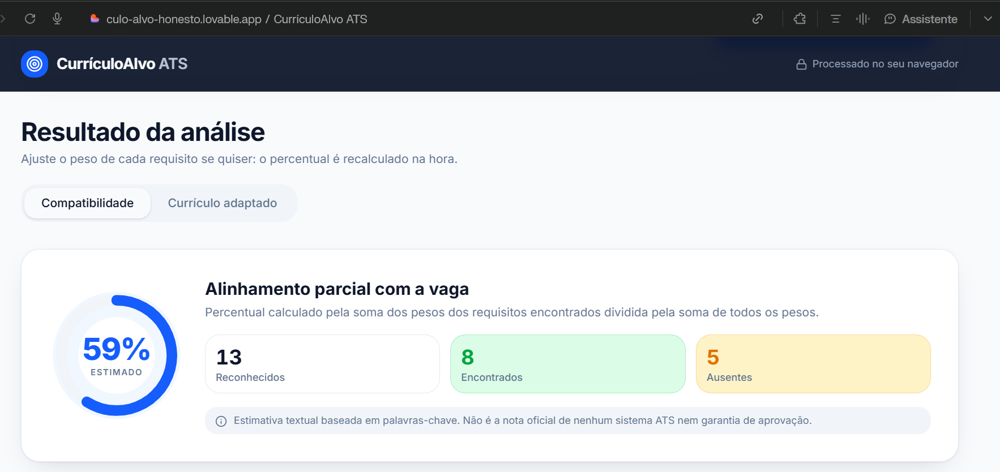

CurrículoAlvo ATS 🎯
Seu talento merece ser encontrado.

Aplicação web criada com Lovable para comparar currículos com descrições de vagas, estimar a compatibilidade com requisitos reconhecidos e gerar uma versão reorganizada, editável e exportável em PDF — sem inventar experiências ou competências.

Aplicação: https://culo-alvo-honesto.lovable.app/
Código-fonte: https://github.com/Black2026/culo-alvo-honesto-a12ee017
Projeto Lovable: https://lovable.dev/projects/44fb4460-d4c7-4567-8bea-23a9f986dee1
Problema que resolve
Mesmo candidatos qualificados podem apresentar currículos pouco alinhados à linguagem de uma vaga. O CurrículoAlvo ATS ajuda a identificar competências mencionadas na oportunidade e presentes no currículo, mostrar lacunas e reorganizar somente informações reais para facilitar a leitura.
Regra ética: a aplicação não adiciona automaticamente competências ausentes, resultados, cargos, empresas, datas, certificações ou formações não informados pelo candidato. O percentual de match é uma estimativa textual, não uma pontuação oficial de um ATS nem garantia de aprovação.

Funcionalidades
- Campos para colar a descrição da vaga e o currículo, com validações e contadores de caracteres.
- Exemplo fictício para demonstração e opção de limpar dados com confirmação.
- Indicador de compatibilidade estimada, com — quando não há requisitos reconhecidos.
- Identificação de requisitos encontrados e ausentes, com trechos de evidência.
- Pesos ajustáveis: essencial, importante, desejável ou ignorar.
- Inclusão manual de requisitos não identificados automaticamente.
- Geração determinística de currículo adaptado, reorganizando conteúdo existente sem inventar fatos.
- Editor, cópia de texto, restauração de versões e download em PDF com texto selecionável.
- Interface responsiva em português brasileiro.
Fluxo de análise: da vaga ao PDF
1. A pessoa cola a descrição da vaga e o texto do currículo.
2. O sistema normaliza o texto e reconhece termos de um vocabulário local.
3. Compara os requisitos reconhecidos com o currículo e apresenta evidências para cada resultado.
4. Calcula o percentual estimado com base nos pesos, que podem ser revisados pelo usuário.
5. Reorganiza as seções e prioriza informações relevantes já existentes no currículo.
6. Exibe sugestões separadas quando faltam informações, sem inseri-las automaticamente.
7. O usuário revisa e edita o currículo antes de copiar ou exportar o PDF.
Exemplo demonstrativo
No cenário fictício de Analista de Dados Júnior, o resultado relatado foi 59% de compatibilidade, com Excel e análise de dados encontrados. SQL, Power BI e Python foram identificados como ausentes e não foram incluídos no currículo adaptado. O percentual é específico do exemplo e dos pesos utilizados.
Tecnologias
O projeto exportado utiliza React, TypeScript, Vite, Tailwind CSS, componentes shadcn/ui/Radix, Lucide, TanStack Start/Router, jsPDF e Vitest. A análise do MVP foi concebida para funcionar localmente no navegador, sem login, banco de dados ou API paga de análise.
Construção com Lovable e evolução do prompt
1. Referência inicial: existia uma implementação independente em React, TypeScript e Vite, que serviu como referência de funcionalidades. Essa primeira versão não foi feita no Lovable.
2. Mega prompt: foi elaborado um prompt único em Markdown com identidade visual, design system shadcn/ui, telas, fluxo ATS, privacidade, exportação PDF, critérios de teste e a regra de não inventar informações.
3. Planejamento e geração: o documento foi anexado ao Lovable, que analisou a proposta, planejou a estrutura e gerou uma nova aplicação após autorização.
4. Evolução funcional: a versão Lovable passou a oferecer evidências por requisito, ajuste de pesos, requisitos manuais, geração de currículo reorganizado, edição e PDF. A mudança essencial em relação à referência inicial foi ir além da simples normalização do texto e produzir uma versão reorganizada baseada em fatos existentes.
5. Publicação e sincronização: a aplicação foi publicada no endereço acima e sincronizada com este repositório GitHub.
Registro fiel dos refinamentos: não são atribuídos prompts adicionais ao Lovable sem evidência. Novos comandos de refinamento, se realizados, devem ser acrescentados aqui com sua justificativa.
Testes e validação
O relatório do Lovable informou 18 verificações automatizadas aprovadas, cobrindo cálculo de compatibilidade, ausência de porcentagem arbitrária e preservação de informações. O fluxo de exemplo, análise, pesos, geração, edição e exportação foi relatado como testado em computador e celular. O responsável confirmou também o funcionamento dos botões Copiar e Baixar PDF em navegador real.

Para reproduzir os testes localmente, com Node.js e npm instalados:
npm install
npm run test
npm run build
npm run dev
Evidências visuais recomendadas: incluir futuramente capturas reais da tela inicial, resultado de compatibilidade, currículo adaptado e PDF gerado em docs/evidencias/. Não referenciar imagens antes de adicioná-las ao repositório.
Limitações conhecidas
- Vocabulário automático limitado a aproximadamente 100 termos; outros podem ser adicionados manualmente.
- A detecção de uma competência não verifica o nível de proficiência exigido.
- Currículos são inseridos como texto; não há importação direta de PDF ou Word.
- Títulos incomuns de seções podem impedir sua reorganização automática.
- Os pesos inferidos pela estrutura da vaga precisam ser revisados.
- A validação específica de download no Safari/iPhone após a publicação ainda não foi confirmada.
Privacidade
O processamento foi concebido para ocorrer no navegador, sem persistência de currículos em banco de dados. Evite usar dados pessoais reais em capturas públicas, issues ou exemplos de documentação.

## Evidências da aplicação

### 1. Entrada da vaga e do currículo


### 2. Resultado da análise ATS


### 3. Currículo adaptado


# CurriculoAlvo ATS

# MEGA PROMPT — CURRÍCULOALVO ATS
## Desafio DIO | Versão 1.0 | Lovable

### 1. Objetivo

Crie uma aplicação web profissional chamada **CurrículoAlvo ATS**, totalmente em português do Brasil, que compare o currículo de um candidato com a descrição de uma vaga e produza uma versão otimizada e editável, seguindo boas práticas de legibilidade para sistemas ATS.

O propósito é ajudar profissionais a apresentar melhor suas experiências reais, sem inventar informações.

**Frase principal:** Seu talento merece ser encontrado.

**Regra inegociável:** A aplicação nunca deve inventar experiências, competências, resultados, certificações, formações, cargos ou períodos profissionais.

### 2. Tecnologias e arquitetura

Utilize:
- React, TypeScript e Vite.
- Tailwind CSS e shadcn/ui.
- Componentes acessíveis e responsivos.
- Ícones Lucide.
- Processamento local no navegador para o MVP.
- Sem login, banco de dados, backend ou APIs pagas.
- Sem depender de serviços externos para a análise.
- Código organizado, reutilizável e preparado para exportação ao GitHub.

Priorize um MVP completo, confiável e funcional, sem funcionalidades extras desnecessárias.

### 3. Identidade visual

Crie uma interface moderna, elegante e profissional, com aparência de plataforma de tecnologia voltada à carreira.

Paleta:
- Azul-marinho: #0F172A
- Azul principal: #2563EB
- Azul claro: #DBEAFE
- Fundo: #F8FAFC
- Branco: #FFFFFF
- Texto secundário: #64748B
- Verde de sucesso: #16A34A
- Âmbar de atenção: #D97706

Utilize tipografia Inter, cards com cantos arredondados, espaçamento generoso, contraste adequado e animações discretas.

A interface deve funcionar em desktop, tablet e celular.

### 4. Tela principal

Cabeçalho com o nome **CurrículoAlvo ATS**.

Seção de destaque:
- Título: "Seu talento merece ser encontrado."
- Subtítulo: "Compare seu currículo com uma oportunidade, descubra pontos de melhoria e prepare uma versão mais alinhada à vaga."
- Aviso: "Melhoramos a apresentação das suas experiências reais. Nunca inventamos qualificações."

Inclua dois campos amplos:
1. Descrição da vaga.
2. Currículo atual.

Adicione contadores de caracteres, validação de conteúdo e os botões:
- Analisar compatibilidade.
- Carregar exemplo fictício.
- Limpar dados.

### 5. Motor de análise ATS

Reaproveite como referência a abordagem de análise determinística do projeto original.

Implemente:
- Normalização de texto, acentos e caixa.
- Identificação de competências técnicas e termos profissionais.
- Comparação de requisitos da vaga com o currículo.
- Reconhecimento de palavras-chave encontradas e ausentes.
- Evidências textuais para termos encontrados.
- Pesos configuráveis para requisitos.
- Percentual estimado de compatibilidade.

O resultado deve apresentar:
- Match estimado de 0 a 100%, quando houver requisitos reconhecidos.
- Total de requisitos encontrados.
- Total de requisitos ausentes.
- Lista de palavras-chave encontradas.
- Lista de palavras-chave ausentes.
- Recomendações práticas e explicáveis.

Não apresente uma porcentagem fictícia quando não houver requisitos reconhecidos.

Deixe explícito que a pontuação é uma estimativa textual, não uma nota oficial de um ATS nem garantia de aprovação.

### 6. Geração do currículo adaptado

Implemente a funcionalidade **Gerar currículo adaptado**.

Ela deve produzir uma versão melhor organizada do conteúdo original, priorizando informações relevantes para a vaga.

A geração deve:
- Preservar os fatos fornecidos pelo candidato.
- Organizar seções profissionais reconhecíveis.
- Melhorar clareza, estrutura e legibilidade.
- Destacar competências já presentes no currículo.
- Reorganizar informações existentes conforme a relevância para a vaga.
- Evitar tabelas complexas, colunas e elementos decorativos no currículo exportado.
- Preservar datas, cargos, empresas, formação e resultados exatamente quanto aos fatos informados.
- Permitir revisão e edição manual antes da exportação.

**Não adicionar automaticamente palavras-chave ausentes como se fossem competências comprovadas.**

Como não haverá integração com IA externa, implemente um gerador determinístico e transparente, utilizando regras locais de reorganização e formatação.

Não simule uma geração por IA nem afirme que houve reescrita inteligente quando isso não tiver ocorrido.

Quando uma melhoria exigir informações que não estejam no currículo, apresente uma sugestão separada para o candidato avaliar, sem incorporá-la automaticamente.

### 7. Resultado e edição

Organize os resultados em abas:

**Compatibilidade**
- Indicador visual de match.
- Competências encontradas.
- Competências ausentes.
- Evidências e recomendações.

**Currículo adaptado**
- Texto gerado a partir das informações existentes.
- Editor completo e funcional.
- Botão para restaurar a versão original.
- Botão para copiar o texto.
- Botão para exportar em PDF.

Mostre um aviso para o usuário revisar todas as informações antes de utilizar o documento.

### 8. Exportação em PDF

Implemente exportação funcional, preferencialmente com download direto de PDF.

O arquivo deve:
- Conter somente o currículo adaptado.
- Utilizar layout limpo, profissional e ATS friendly.
- Manter texto selecionável.
- Preservar acentuação e quebras de linha.
- Evitar gráficos, imagens e elementos desnecessários.
- Permitir múltiplas páginas quando necessário.
- Não incluir botões, menus ou componentes da interface.

Se o download direto não puder ser implementado de maneira confiável, disponibilize uma visualização específica para impressão e a opção "Salvar como PDF", com instruções claras.

### 9. Privacidade e segurança

- Não armazenar currículos em servidores.
- Não enviar informações pessoais a APIs externas.
- Não exigir autenticação.
- Não incluir chaves ou segredos no código.
- Evitar registrar dados pessoais em logs.
- Não utilizar conteúdo fornecido pelo usuário como HTML executável.
- Permitir limpar os dados da sessão.

### 10. Exemplo demonstrativo

Inclua um exemplo fictício de vaga para Analista de Dados Júnior, com Excel, SQL, Power BI, Python e análise de dados.

Inclua currículo fictício com experiência acadêmica em análise de dados e Excel, sem afirmar conhecimentos não informados.

O exemplo deve permitir demonstrar:
- Requisitos encontrados.
- Requisitos ausentes.
- Percentual estimado.
- Currículo adaptado.
- Exportação PDF.

### 11. Testes e critérios de aceitação

Verifique:
1. Campos vazios exibem mensagens claras.
2. A análise funciona com textos válidos.
3. O percentual é coerente com os pesos reconhecidos.
4. Termos ausentes não são apresentados como comprovados.
5. A versão adaptada preserva os fatos do currículo.
6. A edição manual funciona.
7. O PDF contém somente o currículo.
8. A aplicação funciona em dispositivos móveis.
9. Não há erros de execução.
10. O projeto pode ser publicado e exportado para o GitHub.

### 12. Entrega

Crie a aplicação completa com o núcleo funcional, priorizando estabilidade e qualidade.

Não adicione login, dashboard, histórico em banco de dados ou integrações pagas.

Mantenha o nome **CurrículoAlvo ATS** e uma interface totalmente em português brasileiro.

Ao finalizar, informe o que foi implementado, eventuais limitações e o que ainda precisa ser testado antes da publicação.

This project was built with [Lovable](https://lovable.dev).

**Live app**: https://culo-alvo-honesto.lovable.app

## Build with Lovable

Continue developing this project in the [Lovable editor](https://lovable.dev/projects/44fb4460-d4c7-4567-8bea-23a9f986dee1).

- **Ship faster**: describe what you want to build and Lovable handles the code.
- **Stay in sync**: every change made in Lovable is committed straight to this repository.
- **Full ownership**: this code is yours. Push to `main` on GitHub and your changes sync back into Lovable, ready for your next prompt.

## Development

Prefer working locally? You need Node.js and npm — [install with nvm](https://github.com/nvm-sh/nvm#installing-and-updating).

```sh
git clone <this-repository-url>
cd <repository-name>
npm i
npm run dev
```
